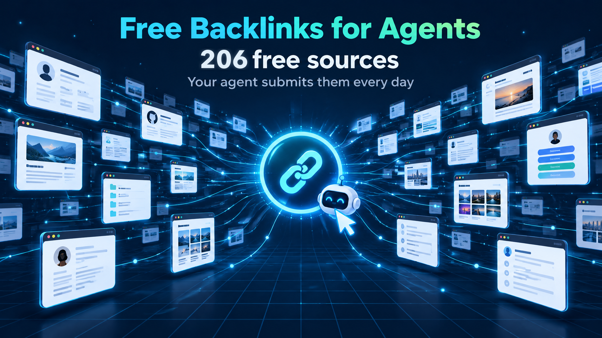

# Free Backlinks for Agents




**Language:** [简体中文](README.md) · English

**206 free backlink sources. Our own agents signed up, submitted, then logged out and checked the link on every one.** Nine more sites whose free entry point we verified but have not submitted yet are listed separately. Hand the repo to GrokBot, Claude Code or Codex: it signs up, reads its verification emails, submits, and keeps going every day.

## Contents

- [Quick start](#quick-start)
- [What's inside](#whats-inside)
- [Fields](#fields)
- [Inclusion rules](#inclusion-rules)
- [Using it by hand](#using-it-by-hand)
- [Contributing](#contributing)
- [FAQ](#faq)

## Quick start

Send this to your agent:

```text
Read https://github.com/HiAPIAI/free-backlinks-for-agents and use
skills/submit-backlinks to post 8–10 free backlinks a day for my product.

Product: <name>
Website: <https://example.com>

Sign up with your own inbox and fetch verification codes yourself.
Run every day at 1 a.m. and send me a daily report.
```

The agent picks sites from [data/backlinks.csv](data/backlinks.csv), skips the [known dead ends](skills/submit-backlinks/references/known-blocked.md), and checks every link while logged out before counting it.

## What's inside

Full table: **[backlinks.md](backlinks.md)** (headers in Chinese; the CSV has English field names).

| Category | Count | What it is | How you get the link |
|---|---:|---|---|
| [AI tool directories](backlinks.md#ai-tools) | 72 | Directories of AI products | Mostly a form, many without login |
| [Product & software directories](backlinks.md#products) | 48 | SaaS, alternatives, reviews, launch boards | Form, or an account plus a product page |
| [Web directories](backlinks.md#web) | 16 | General link directories | Form |
| [Profile pages](backlinks.md#profiles) | 70 | Code hosting, portfolios, link-in-bio, document sharing | Create an account, put the link on your profile |
| [Entry verified, not yet submitted](backlinks.md#entry-verified) | 9 | Submission page says free; we have not posted yet | See the table |

## Fields

| Field | Meaning |
|---|---|
| `site` | Site name |
| `submit_url` | Submission or sign-up page |
| `category` | `ai-tools` / `products` / `web` / `profiles` |
| `submit_method` | How the link is obtained: form, profile link, pull request… |
| `needs_account` | `yes` / `no` / `unknown` |
| `link_rel` | `dofollow` / `nofollow` / `untested`. Only set when we read the page source while logged out |
| `monthly_visits` | Whole-site monthly visits (Semrush / Traffic.cv estimate), for reference only |
| `last_submitted` | Last date we got a live link there |
| `status` | `submitted` · `to-recheck` (⏳) · `entry-verified` |

Common filters: `link_rel == dofollow`; `needs_account == no`; sort by `monthly_visits`.

## Inclusion rules

**In:** a free, public, clickable link, and either we actually got one, or the submission page states it is free and we opened it ourselves (kept in a separate section).

**Out:** paid-only or long paid-skip queues; reciprocal links or badges; Google / GitHub / phone / real-ID-only sign-up; blog comments; links that disappear when logged out; unverified bulk URL dumps.

## Using it by hand

Open [backlinks.md](backlinks.md), start with the category closest to your product, and do a few a day. Have ready: product name, one-line pitch, a ~100-word description, website URL, logo. On profile sites, fill the Website field or put the full URL in the bio.

## Contributing

See [CONTRIBUTING.md](CONTRIBUTING.md). Broken entry, now paid, or switched to nofollow: open an [issue](../../issues/new/choose) or a PR. New sources must be free and submitted by you, with the date and a public page that shows the link while logged out.

## FAQ

**Do directory links help?** One directory carries little weight; the value is in volume, relevance and time. Start with the category closest to your product.

**Will this look spammy?** One submission per site, copy written for each site, no comment sections or link farms.

**What does "—" mean?** We have not checked the link attribute. It does not mean nofollow.

## License

[MIT](LICENSE) · Maintained by [HiAPI](https://www.hiapi.ai)
